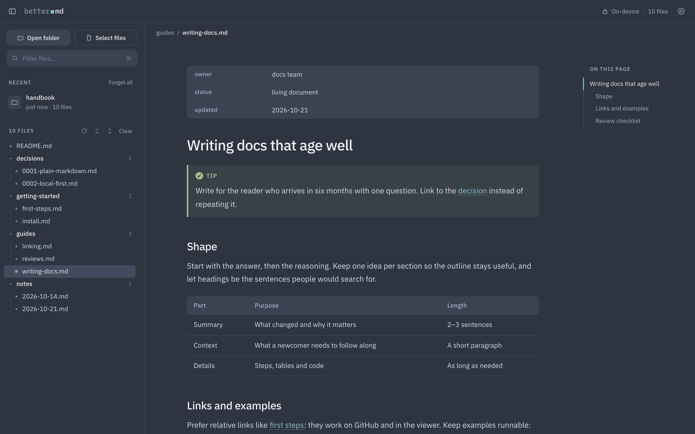
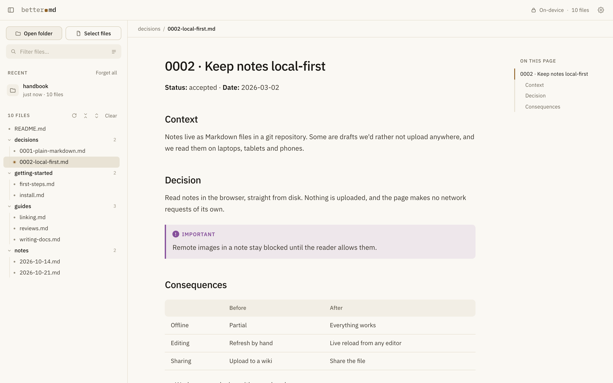
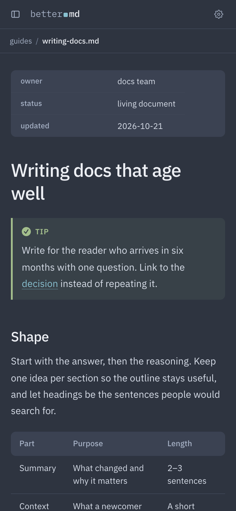
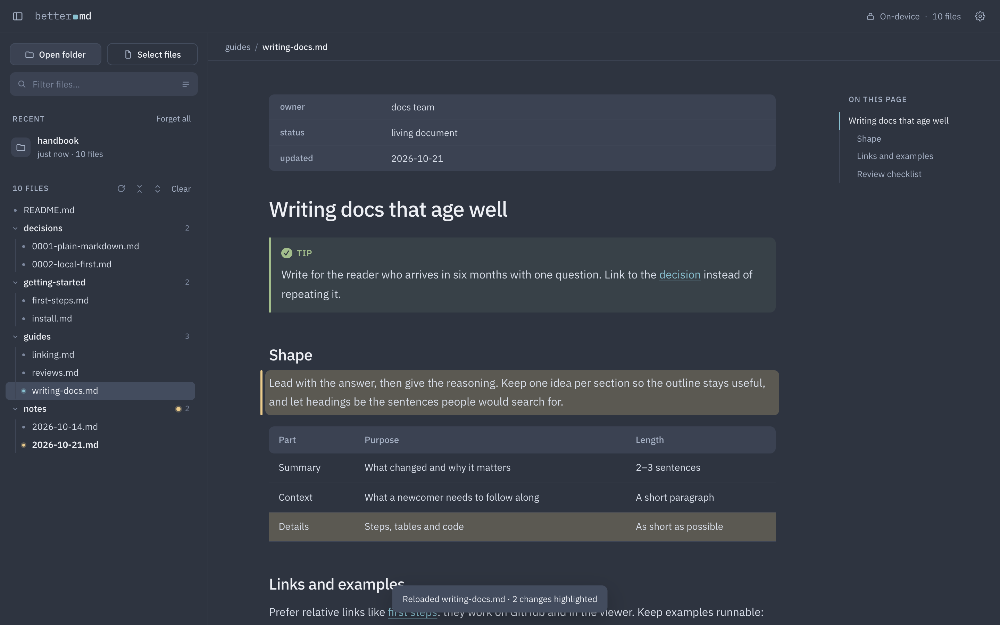

# Better MD viewer

A calm reader for folders of Markdown that runs entirely in your browser. Open a folder and read: nothing is uploaded, nothing is installed, and the page makes no network requests of its own.

**[Open the viewer →](https://asilachev.github.io/better-md-viewer/)**

## Features

- **Whole folders, not single files.** A compact tree with collapsible folders, a filter by name, and search inside files with match counts. Click a `#tag` to find every file that uses it.
- **Links that work.** Relative links, images, `#heading` anchors and `[[wiki links]]` resolve inside the folder, and the URL follows the file and heading you're on.
- **GitHub-flavoured Markdown.** Tables, task lists, alerts (`> [!NOTE]`), footnotes, frontmatter and syntax highlighting, with a Copy button on code blocks.
- **Live reload.** The open file re-renders when it changes on disk and highlights what changed. New or deleted files show up on their own, and the tree marks files that changed since you last opened them.
- **Picks up where you left off.** Recent folders and the last file you read are remembered in the browser, and going back to a file returns you to where you were in it.
- **Private by design.** Fonts and libraries ship with the page, a Content-Security-Policy keeps it local, and remote images stay blocked until you allow them.
- **Comfortable to read.** An outline of headings, twelve themes or one that follows your system's light and dark mode, adjustable type and width, a layout for phones, and clean printing.

## Use it

1. Open [the hosted viewer](https://asilachev.github.io/better-md-viewer/), or clone this repo and open `index.html`. There is no build step and no server to run.
2. Click **Open folder**, or drag a folder onto the page.

Chrome, Edge and Arc read the folder directly, which is what makes live reload and reopening recent folders work. Safari and Firefox fall back to a file picker that reads a one-time copy; the browser calls it an upload, but the files never leave your machine.

## Keyboard

| Key | Action |
|---|---|
| `⌘O` / `Ctrl O` | Open a folder |
| `j` / `k` | Next / previous file |
| `/` | Search (`Esc` clears it) |
| `⌘B` / `Ctrl B` | Show or hide the sidebar |

## Screenshots

  
  

After a live reload, the edited paragraph and table row are highlighted, and the tree marks a note that changed in the background:

## How it works

Plain HTML, CSS and JavaScript, with no build step and nothing to install. [marked](https://marked.js.org) turns Markdown into HTML, [DOMPurify](https://github.com/cure53/DOMPurify) sanitizes it, and [highlight.js](https://highlightjs.org) colours code. Folders are read through the File System Access API where the browser has it.

| File | What's in it |
|---|---|
| `index.html` | Page structure and the Content-Security-Policy |
| `assets/app.js` | Reading folders, rendering, links, live reload, search |
| `assets/style.css` | The design system; each theme sets a small palette |

## Third-party code

- [marked](https://github.com/markedjs/marked): MIT
- [DOMPurify](https://github.com/cure53/DOMPurify): Apache-2.0 or MPL-2.0
- [highlight.js](https://github.com/highlightjs/highlight.js): BSD-3-Clause
- [IBM Plex](https://github.com/IBM/plex) fonts: SIL Open Font License 1.1 (`assets/fonts/LICENSE.txt`)

## License

MIT. See [LICENSE](LICENSE).
